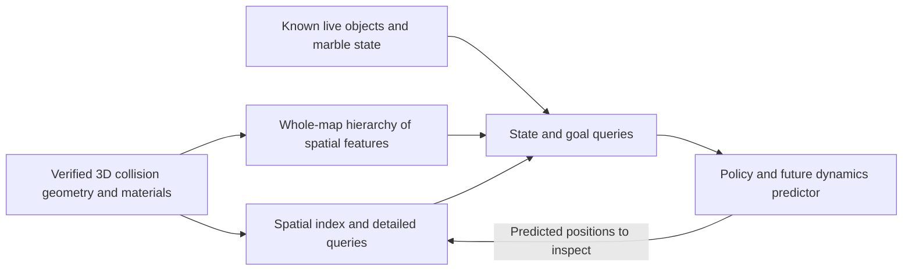

# Map representation research and handoff, 2026-10-11

## Outcome and scope

Recommendation: retain a complete, queryable 3D collision map, derive a hierarchy of learned spatial features from it, and let the policy and future dynamics predictor request detail anywhere in the level. Keep the current local view as one input during a migration. A larger floor image alone cannot represent the collisions needed for general powerup use.

The operator's clarification during this research: every surface the marble can touch should be represented, including surfaces it could bounce from; faces buried inside solid geometry and geometry it cannot contact may be unnecessary. This is the representation's coverage requirement. It must not be reduced to surfaces the marble can currently walk on, or to tricks someone has listed.

The available game assets and local engine source make this feasible. The existing exporters are useful starting points, but they do not establish complete collision coverage. In particular, they omit shape-based geometry present on two current training maps. Exact exporter coverage and model inference cost remain to be demonstrated.

This task performed research and a read-only asset audit. It did not change game scripts, training code, observations, rewards, checkpoints, map caches, or training state. No game or optimizer was launched. The latest training log records that the other run stopped at 19:41 on October 11; process inspection found no trainer/evaluator/game running. This task did not stop that run.

Evidence: [raw audit](MAP_REPRESENTATION_AUDIT_2026-10-11.json) and [reproduction script](research/map_representation_audit_20261011.py). Run the script from the repository root with the existing Python 3.9 environment. It reads assets and replaces only its research JSON report. The audit is static evidence, not new engine validation.

## What ideal access means

The model should be able to obtain:

| Information | Purpose |
|---|---|
| Collision surface positions, orientations, boundaries and object transforms in 3D | Predict floor, wall, underside, ramp and edge contact anywhere along a trajectory |
| Per-surface physical material properties | Distinguish friction, restitution, applied forces and special material behavior |
| Solid/free/unknown space, where established | Avoid predicting motion through walls; distinguish absent geometry from missing data |
| Exact legal bounds and gameplay trigger volumes | Distinguish a lower surface from an out-of-bounds outcome, and preserve spatial game effects |
| Live gems and powerups, their positions and known availability | Supply objectives and resources without changing static terrain features |
| Moving objects' current transforms and motion information | Predict contact with time-dependent geometry |
| Marble position, velocity, spin, collision radius, gravity, inventory and active effects | Interpret the map in the current physical state |
| A full-level overview plus precise queries at arbitrary coordinates | Relate distant geometry to the goal, then resolve the details of proposed movement |

Geometry and effects are facts. Whether a surface is useful, a maneuver is worthwhile, or an area is reachable with a particular inventory belongs to the dynamics model and decision process.

For example, a slick slope is still geometry even if rolling up it is impossible. A vertical wall is still geometry even if it cannot support the marble. A ceiling is still geometry even if it has no floor on top. Ordinary-jump reachability must not determine which surfaces exist in the representation.

The current goal and the rest of the live item set should have separate dynamic features. Static spawn locations do not establish that an item is currently present. Unknown item availability must stay unknown.

## What the current policy actually receives

`nav/terrain.py` sets a 32 by 32 fine crop at 0.5-unit spacing and a 32 by 32 coarse crop at 2-unit spacing. Their approximate footprints are 16 and 64 units across, with sample centers extending 7.75 and 31 units from the marble. The comments saying these distances are "each way" are inaccurate. No comments were edited in this research.

Each crop has three channels: the nearest represented floor's relative height, whether that floor exists, and the second-nearest floor's relative height. These are selected from the layered height stack. Relative heights saturate at plus/minus 10 units. The crop does not give the policy all stored floor levels, exact surface normals, or per-surface material channels. Terrain files contain slope and friction, but those arrays are not channels of this crop.

There are also 16 floor-following edge rays extending 20 units, a target-ray block, navigation/target-related vectors, marble state, powerup features and recurrent memory. The rays are terrain-map lookups, not rendered camera vision and not general 3D collision rays.

The current recorder selects surfaces through `climbable(normal, friction)`. It uses some other faces to remove covered/solid floor samples, but the final artifact is a layered floor representation, not a collision mesh. Material properties and geometry matter outside that floor selection. A dynamics learner cannot recover an omitted wall or ceiling from a reward change.

Sources: `nav/terrain.py:60`, `nav/terrain.py:147`, `nav/obs.py:248`, `terrain_obs.py:75`, `generate_terrain_map.py:304`.

## Feasibility audit of the ten real maps

I loaded the ten exact configured missions and their referenced DIF assets using the existing parser and transform code. This read 21 unique DIF files and extracted candidate triangles, normals and texture identities without rasterizing new maps or launching the engine. All those DIFs have a single detail level.

| Map | Candidate interior triangles | Estimated triangle/normal/material storage, MiB |
|---|---:|---:|
| King of the Marble | 1,752 | 0.09 |
| Sprawl | 5,075 | 0.25 |
| Cube Isle | 2,286 | 0.11 |
| Bowl | 2,876 | 0.14 |
| Duplex | 10,305 | 0.51 |
| Fractured Islands | 5,923 | 0.29 |
| Cragmire | 11,316 | 0.56 |
| Vortex Effect | 8,193 | 0.41 |
| Treasure Box | 5,328 | 0.26 |
| Concentric | 2,764 | 0.14 |

Total: 55,818 triangles. Storage estimates use float32 vertex coordinates and normals plus one int32 material index per triangle. They exclude indexing, learned features, shape-based geometry, metadata and optimizer memory. Counts are triangles produced from the existing render-surface extractor, not certified counts of physically accessible collision faces. Multiple triangles may form one surface.

This supports the operator's expectation that an explicit geometric representation can be small. It does not imply that dense neural processing of all triangles every 64 ms is cheap.

Dense full-level voxels are a poor default. For illustration, a float32 channel over Cragmire's full candidate mesh bounding box at 0.25-unit spacing would take about 15.3 GiB. That box includes large enclosure/decorative geometry and is not the playable area. The estimate illustrates how empty/decorative volume inflates dense storage; it is not a claim that Cragmire requires that much memory. Sparse geometry avoids this volume cost.

## Existing work that can be reused

`nav/learned_nav/geometry.py` already exports triangles, normals, material indices, friction/restitution/force values, a layered raster and exact edge segments. Some older `_phys` missions have floor/ramp/lip verification reports. This is substantially closer to the desired source representation than the current policy's crop.

However, the older artifact must not be accepted wholesale as the new geometry contract:

* It scans InteriorInstance assets only. Duplex contains 42 glass StaticShape instances. Concentric contains 16 TSStatic instances, including glass assets. Neither interior-only exporter represents these objects. Script/engine source confirms separate shape collision pathways, but this research did not probe each object's actual collision in the running game.
* `extract_surfaces()` iterates ordinary DIF surfaces. The local engine's collision code selects surfaces through convex hull references, uses collision winding/fan masks, and can include null surfaces. No hull-referenced null surfaces were found in the 21 DIFs audited here, so that omission is a general coverage risk, not a demonstrated missing face on these maps.
* The old geometry collector asserts one detail level. The current generic extraction iterates all levels. The engine's InteriorInstance collision path uses detail level zero. All audited assets have one level, but a general exporter needs to follow the collision convention explicitly.
* The old floor-oriented query and verification APIs do not establish sphere contact or swept collision correctness for arbitrary walls, ceilings, glass and fast diagonal motion.
* Old `_phys` verification reports do not establish that a freshly exported current mission, including all object classes, is correct.

The old and current material tables both have 97 mappings. A comparison found no friction disagreements for textures used by these ten maps. There is no basis from this audit to report a material-parser bug. Runtime material values, defaults and special behavior still need validation. For example, `RandomForceMaterial` uses a negative friction marker, and bouncy material uses an applied force; reducing these to ordinary friction would lose behavior.

## What the game can expose

| Component | Existing evidence | Remaining work |
|---|---|---|
| Interior geometry | DIF vertices, planes, surfaces, convex hull references, null surfaces and object transforms are parseable | Export the actual collision surface selection and verify normals/winding/material attribution |
| Shape-based collision | Mission StaticShape/TSStatic objects reference DTS assets; local engine has `ShapeBase::buildPolyList` and `TSStatic::buildPolyList` | Use their collision details through a reliable DTS reader or an engine export hook; include actual transforms |
| Surface materials | `data/init.cs` mappings; old geometry exporter; engine contact telemetry | Verify resolved values and special material semantics against engine contacts |
| Bounds/triggers | Mission polyhedra and transforms; runtime trigger objects | Represent full transformed volumes and game semantics, not just the current recorder's z-range |
| Live objectives/resources | Observer reads current ghosted gems; powerup scan; local replay item catalog | Export variable-length known object state with IDs, timestamps and validity |
| Moving geometry | Mission objects/scripts and runtime transforms | Add time-dependent transform/state observations and geometry invalidation |
| Physical state | Position, velocity, spin, held items/effects and optional contact telemetry | Add missing radius/gravity/configuration fields to the representation contract |

Relevant local engine source is available under `C:/Users/doug/src/OpenPQ-TGEMIT-mbx`. In that source, InteriorInstance uses detail level zero for collision; `Interior::buildPolyList` enumerates hull-selected ordinary/null surfaces; shape objects enumerate separate collision details. Source inspection establishes an implementation route, not that a complete export command already exists in the installed binary. No engine source or binary was changed.

A bulk engine collision export is my preferred long-term authority: it can follow the same object classes, detail selection and transforms as marble collision. The offline asset route can supply an initial static representation, but should be compared with engine queries. Extending an exporter is general infrastructure, not a separate maneuver solution.

In an offline hosted training game, server-side state is available. A remote lobby client has only its available assets and ghosted/current client state. The current observer already contains distinct host/client paths. The deployed representation must not quietly depend on server-only item timers, unghosted objects or future random spawns. Use explicit known/unknown values and test the client path separately.

## Recommended representation

Use one geometric source with several derived views:

### 1. Detailed collision source

Keep triangles/polygons with normals, material properties, object identity, collision flags and local-to-world transforms. Preserve edges and thin geometry. Store source hashes, engine/configuration version, coverage status and bounds/trigger definitions. Add a spatial index for fast nearby-face, distance, ray and swept-volume queries.

The marble is a sphere, not a point. Queries must account for its current collision radius, including Mega Marble. A narrow opening can be clear to a ray and impassable to the sphere. Prediction also needs edge and corner contacts, not only support height. Signed-distance/occupancy views are useful only once solids and inside/outside are reliable; an incomplete open render mesh cannot safely establish those signs.

Retain all collision faces initially. Prune decoration or buried faces only after their inability to affect legal marble contact is established. Interior-facing tunnel walls and box undersides are relevant. Boundaries cannot be pruned merely because their normals are steep or because the existing ground graph calls them unreachable. Broad bounding boxes are fine for indexing but do not replace precise surfaces.

### 2. Whole-map feature hierarchy

Partition geometry automatically into spatial tiles or surface patches. Each patch retains its location, extent, normals/material summaries and a link to its detailed faces. Build coarser groups above them. This gives a variable-size memory describing the whole map, with physically meaningful coordinates and relationships.

Encode it with a compact hierarchy of point/surface features and attention. Let state/goal queries attend across the entire map, with additional detail near the marble and at any queried coordinate. Do not restrict retrieval to the nearest patches or current ground route: those restrictions would recreate the distant-platform blind spot.

A geometric graph may express adjacency, shared boundaries, containment and spatial relationships. A graph edge must not mean "the marble can cross here" unless that is separately predicted. Surfaces across a gap remain available to attention and trajectory queries even without a walking edge. Neither nodes nor edges require named tricks.

Detailed queries should be available around any predicted future position and along the intervening swept path. That includes mid-flight obstacles and possible bounce contacts, not just departure and destination patches. A learned overview is compressed and may miss something; the detailed source remains independently queryable.

Use relative positions for local physical prediction and preserve distances/heights in interpretable physical units. Avoid normalizing every whole map to a unit cube without scale information, or clipping all height differences to 10 units. Translation/rotation augmentations can encourage transfer, but gravity, normals, velocity and actions must transform consistently. Global context and local physics need not use identical encodings.

### 3. Dynamic layer

Keep live gems, resources, moving geometry and current marble/effect state separate from static geometry. Give each object an ID, transform, known state and age/validity. Static terrain can be loaded once per mission; dynamic state updates each decision. Moving objects can reuse local geometry while updating transforms.

Static assets can be cached immediately. Learned feature caches need invalidation when encoder weights change; actor collection and PPO replay must use the intended observation/version and consistent distributions. Do not permanently detach cached learned features while claiming the geometry encoder is training.

A starting engineering experiment could use hundreds to a few thousand overview tokens plus detailed local queries. These are proposed scales, not measured limits. Benchmark eight-worker collection and one-instance play before choosing a network. The current GPU's memory and latency budgets do not justify adopting a large research backbone without measurements.

## Research comparison

| Representation | Assessment for this game |
|---|---|
| Larger or whole-map height images | Cheap overview/baseline; insufficient as the authoritative contact representation because walls, undersides, multilayer detail and thin objects are lost |
| Dense 3D voxels | Easy spatial indexing but expensive at marble-scale precision over a whole map; useful as small local views |
| Sparse voxels/octrees | Useful hierarchy for occupied/free/unknown space; surface/material detail still needs preservation |
| Points or surface patches | Natural neural input for sparse geometry, normals and materials; sampling/compression must preserve small contact features |
| Detailed mesh plus hierarchical features | Recommended source and interface: exact surfaces for queries, broad learned context for decisions |
| Existing walking graph alone | Useful baseline navigation, but does not represent general collision possibilities or powerup-dependent movement |

[OctoMap](https://octomap.github.io/) demonstrates compact, multiresolution 3D occupancy with occupied/free/unknown distinctions. That supports the storage design principle; this project does not need to recreate sensor SLAM for static assets.

[Point Transformer V3](https://openaccess.thecvf.com/content/CVPR2024/html/Wu_Point_Transformer_V3_Simpler_Faster_Stronger_CVPR_2024_paper.html) provides evidence that broad point-cloud context can be encoded more efficiently using hierarchical/serialized processing. Its recognition results do not establish marble collision accuracy or our hardware latency.

[3D Dynamic Scene Graphs](https://web.mit.edu/sparklab/2020/11/10/3D_Dynamic_Scene_Graphs__Actionable_Spatial_Perception_with_Places__Objects__and_Humans.html) separates metric geometry, entities and relationships at multiple scales. That is relevant to static terrain plus live objects; the proposed game representation can be much simpler than that robotics system.

[PerAct](https://peract.github.io/) is an example of a learned controller consuming structured 3D voxel observations. Its tabletop manipulation setting does not establish that a full-level voxel grid or that particular architecture is appropriate here.

These sources support design options. The recommended hybrid is an engineering inference from this game's assets, contact requirements and measured geometry size, not a result demonstrated by those papers on Marble Blast.

## Proposed first milestone before policy/dynamics training

1. Define a versioned full collision and dynamic-state contract. Explicitly cover object classes, normals, materials, gravity/radius, bounds, unknown states and client deployment.
2. Export a detailed map for representative static missions, including both interior and shape collision. Use Cragmire for stacked geometry, Duplex/Concentric for glass, and Bowl for curved/steep surfaces. This is geometry coverage selection, not a maneuver curriculum.
3. Verify contact geometry against the engine: floors, walls, undersides, glass, edges/corners, steep faces and materials. Include airborne contacts and varied speeds/radii. Existing floor/ramp/lip probes are useful but insufficient.
4. Build a viewer that shows the exported scene, coverage gaps and detailed query results. Overlay engine contact locations/normals on the same geometry.
5. Build and benchmark the hierarchy/query interface without replacing the current policy. Test distant retrieval, narrow features, multilayer queries and coordinates outside the former 64-unit crop.
6. Train a small representation/probe experiment on separate maps only after the exporter passes validation. Test whether queried geometry/material facts survive encoding, including pairs of identical local neighborhoods with different distant surroundings. Then evaluate adding the representation to the policy or dynamics learner under a separately reviewed training plan.

Acceptance is about information fidelity before score: no unexplained engine contact without a represented surface; correct orientation/material and sphere clearance; distant queries distinguish known geometry, empty space and missing coverage; stable transforms and dynamic-object timestamps; measured latency/memory; held-out-map query accuracy. Statistical probes cannot prove every face is correct, so combine exporter invariants, coverage accounting and engine tests.

Better map access enables a general predictor/planner, but does not itself supply powerup physics or guarantee discovery. The next physics learner can predict local transitions while querying the same map along proposed motion. Global map features guide long-term choices; the precise geometric source supports collisions anywhere along the path.

## Changes and remaining work

Added this research handoff, the ten-map static audit JSON, and its reproduction script. Logged the research in `HANDOFF_NAV_TRAINING_LOG.md`. No production bug was fixed; the crop-width comment discrepancy and exporter coverage gaps are findings for future work.

Still unverified: complete collision export, each glass object's actual runtime contacts, safe face pruning, full client-accessible dynamic state, hierarchy fidelity, neural memory/latency, and world-model performance. No training start or architectural migration is implied by this research.
