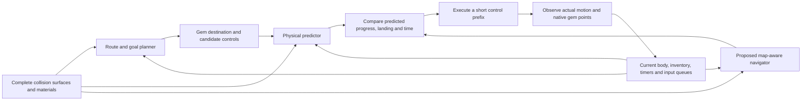

# Physics baseline and full-map learning proposal

Prepared2026-10-13 after native mechanics and input-contract checks. This is a
proposed architecture change for review, not a deployed model or permission to
start long policy training. KOTM remains one equal-weight gameplay map; a modest
dip there never vetoes broader progress.

## Recommendation and evidence

Use the game-derived analytical simulator as the starting physical predictor.
Learn corrections where measured native outcomes disagree, and train a fast
map-aware navigator to make useful gem-collection decisions. Relearning gravity,
jump impulses and power effects from a velocity-drift baseline is currently an
expensive detour: the two latest5000-update physical fits retain only update0.

The analytical predictor, after a generic native float32 radius-product fix,
matches all2496steps in90verified six-training-map pairs, at128/256ms horizons.
Maximum position/velocity/spin errors are3.378e-7u/1.349e-6u/s/2.794e-6rad/s.
The formerly0.079711u Fractured flight_down8 error disappears in both branches;
no audited sample worsens by more than1e-8 in its respective metric. Existing
Concentric and Treasure native fixtures also improve. These finite checks use
known actually applied controls; they do not establish reliable long-flight
planning, live proposed-reply rollouts or unseen-map performance.

Sources: [paired results](RESULT_PAIRED_MECHANICS_2026-10-13.md),
[corrected prefix audit](../dynamics_reports/native_paired_open_loop_r3_20261013/independent_audit.json),
[observable feature interface](../dynamics_reports/observable_context_tokens_20261013/manifest.json).
The earlier unfavorable fit/prefix results stay preserved.

## From a spawn to collecting a gem

The planner chooses actual gem destinations and compares paths/maneuvers using
their predicted states and task cost. The physical predictor answers what a
control does, independent of whether a gem is collected. The navigator supplies
fast proposals; it must receive spatial map context and the real destination,
rather than inherit the old actor's local rays as its only geometry. The loop
reobserves and replans; predicted positions never get replaced by future native
states during an open-loop check.

Cache every static surface once, preserving operative/source triangles, native
planes, material properties and topology. Local physical queries can identify
nearby or swept contacts without discarding the distant surfaces needed for
navigation. A future learned encoder should retain spatial information instead
of compressing the map into an unconditioned mean. Graph/attention implementation
and its runtime cost have not yet been validated.

No ramp-to-platform, edge-hit or power-specific trick catalog is needed. General
controls, spin, contact geometry and materials determine physical outcomes;
the planner/navigator can use those outcomes toward different destinations.

## Interface and remaining work

The separate378-example engineering interface now distinguishes script-held
Mega from empty native inventory and keeps use-button memory, pending controls,
spin, radius, gravity frames, relative active timers and material contact tokens.
Every example reconstructs from original CURRENT observations and known NEW
replies, with NEXT observations used only as targets. All1950Cube faces are
retained; float32 vertex reconstruction error is below0.000002u. Raw object/event
handles, absolute clocks and inactive uninitialized deadlines are excluded.

Before another learned-model experiment:

1. Close or explicitly restrict the remaining state gaps: protected runtime
   mass, external dynamic scene, arbitrary script state and queued authoritative
   world updates. Current observed context is not claimed to be complete hidden
   state. Active gravity interpolation/nonzero pending updates remain untested.
2. Verify the proposed reply-to-world-to-native-motion interface for Mega,
   effect expiration, impacts and spin through longer continuations. The short
   paired checks supply known native controls, which bypass part of this problem.
3. Prepare train-only physical residual targets around the verified simulator,
   with geometry/state/phase integrity checks and ordinary-motion preservation.
   Keep development selection separate and the Bowl/Vortex motion labels closed.
4. Implement and benchmark a full-map proposal/navigator interface before long
   policy training. Teach useful choices from actual pickups/returns/time; a
   physically valid recovery is not automatically a desirable imitation label.
5. Run matched complete native rounds and assess equal-map points, consistency,
   falls/rescues and wall cost. Previous71.2/34.8/27.0 component scores belong to
   their archived controller versions, not to this new contact correction.

The important review decision is whether to adopt physics-assisted learning as
the core architecture. That changes the earlier plan of primarily learning a
physical predictor from drift. Neither this proposal nor the diagnostics starts
long PPO, promotes a policy or demonstrates learned human-level mechanics.

## Authorized implementation update,2026-10-13

The user subsequently directed: 'great, turn that into a fast trained navigator'. The separate full-map navigation implementation and bounded supervised fits are now authorized and underway; the earlier architecture preference question is resolved for this work. See [fast navigator handoff](HANDOFF_FAST_NAVIGATOR_2026-10-13.md). Analyticalphysics remains available, originalA2 unchanged, no defaultpromotion. Firstscratch model nativeSprawl0; residual aroundA2 model7, both exactsource/inputvalid. Fresh20-round10-map learned-vsgeometryA2 pool active. These are navigation decisions fits, not physical-predictor training; broader PPO remains separate.
